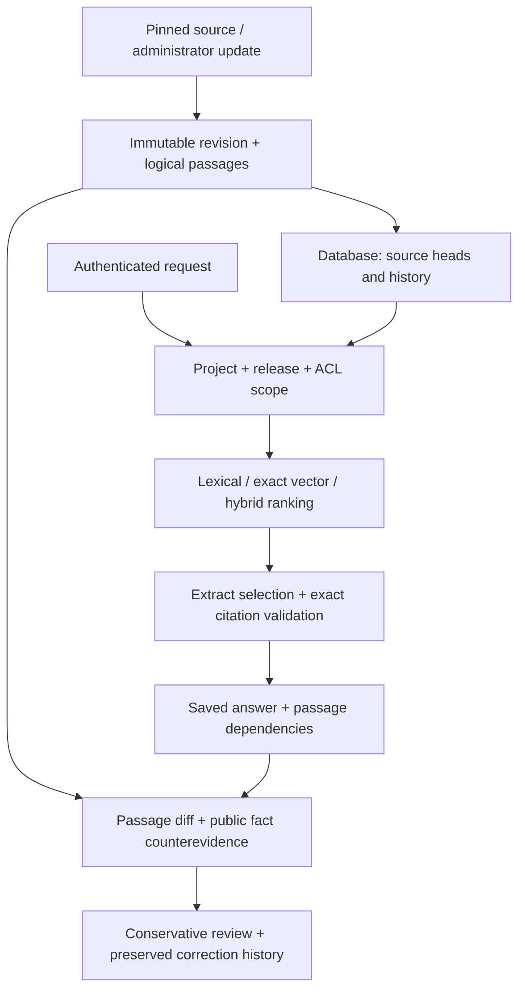

# ReleaseLens

Release-scoped evidence and saved-answer review when documentation changes.

ReleaseLens preserves immutable documentation revisions and exact cited extracts. It records passage dependencies, queues potentially affected saved answers, and preserves the original alongside a review and any separate correction. It is an AI-assisted portfolio implementation with explicit limits; see [resume checkpoint](docs/RESUME.md), [current evidence](docs/STATUS.md), [ownership](docs/OWNERSHIP.md), and [interview materials](docs/interview/README.md).

## Run

Python 3.12; no provider API key for the deterministic baseline:

```bash
python -m venv .venv
# Linux/macOS: source .venv/bin/activate
# PowerShell: .venv\Scripts\Activate.ps1
python -m pip install -r requirements.lock
python -m pip install --no-deps -e .
python -m releaselens --demo
```

Open http://127.0.0.1:8000. The loopback teaching sandbox has synthetic roles, Ask, evidence inspection, version comparison, change/revalidation, evaluation, and access-boundary views. `/docs` serves a static API reference; `/openapi.json` contains the strict schema. Existing demo edits persist; use a fresh `DATABASE_URL` for a separate clean demo rather than deleting work.

For the authenticated PostgreSQL application:

```bash
python scripts/configure.py
# Refuses to overwrite an existing .env; keep credentials private.
docker compose up --build --wait
docker compose exec -T backend python scripts/ingest_sources.py
```

Open http://127.0.0.1:8080 and enter a generated API token. PostgreSQL is internal to Compose and uses a persistent named volume. This is a local deployment on the owner's computer, with a [public GitHub repository](https://github.com/Jill-Vekariya/ReleaseLens); an off-device private host remains unprovisioned. [Operations](docs/OPERATIONS.md) covers safe backups, restore, rollback and secrets.

## Five-minute demonstration

1. Ask Pydantic 1.10.15 about model configuration; inspect an exact source citation. Compare with 2.10.4.
2. As Administrator, open Change intelligence and save the current synthetic timeout answer.
3. Toggle its value; revalidate the old answer. Inspect pending → confirmed stale, preserved original, separate correction and history.
4. Save the current answer, apply a formatting-only update and inspect that it stays unaffected.
5. Probe the restricted canary as Reader and Administrator. Change identity while a request loads; obsolete responses must not render.
6. Explain the measured pilot and its missing independent human review. The [full demo script](docs/interview/README.md) provides timing and caveats.

## Architecture



FastAPI serves the API and buildless HTML/CSS/JavaScript UI. SQLite uses BM25 and in-process exact vectors; PostgreSQL uses FTS and exact pgvector search. Those rankings are different and require separate quality measurements. Production modes enforce project, exact release and permissions before selecting candidates. The deliberately unscoped A/B/C contamination experiments are offline only.

The default hash-384 encoder is a reproducible test double, not learned semantic search. An opt-in pinned 384-dimensional MiniLM encoder is evaluated separately. Model spaces are filtered explicitly; changing encoders requires a fresh index/database. Exact extract membership proves quotation, authorization and release, not relevance or semantic completeness. No fluent generation is enabled by default; the compatible selector has mock and real loopback HTTP tests; a tiny actual local model failed its extract schema, as recorded in the v3 report.

Four original demo pages, plus ten optional expansion pages, are bundled. The original demo pages are: Pydantic 1.10.15/2.10.4 configuration and SQLAlchemy 1.4.54/2.0.36 connections. Each has immutable commit, raw and license hashes, attribution and original license. These are selected snapshots, not complete documentation. `scripts/ingest_sources.py` verifies bytes. HTTP provenance is a trusted administrator assertion, not cryptographic attestation.

## Impact and consistency contract

Cited logical passage changes find dependencies across historical revisions, including intervening formatting changes. Uncited-section changes do not cause blanket document invalidation. Synthetic exclusive fact value changes can be `confirmed_stale`; changed general prose requires manual review. Abstentions are not substantive claims classified incorrect.

Newly introduced **public synthetic structured facts** with a conflicting value can queue existing same-release supported answers even when their cited passages are unchanged. Review returns `manual_review_required`, not confirmed incorrect. Public counterevidence joins cited heads in the idempotency fingerprint. Private counterevidence has no effect on public answer status/fingerprints. This does not detect arbitrary prose contradictions; withdrawal requires an explicit review. See [impact policy](docs/IMPACT_REVIEW.md).

Supported operation is one API process with serialized transactions; commit finishes before a success response. Do not run independent ingestion writers concurrently. Multiworker consistency, organization tenancy, ANN and automatic prose adjudication are proposed in [scale design](docs/SCALE.md), not implemented capabilities.

## Verification and evaluation

```bash
python scripts/verify.py
python -m releaselens.evaluate
python -m releaselens.benchmark --output evaluation/pilot-hash-tuning.json
python scripts/verify_docker.py
python scripts/verify_recovery.py
# Windows installed Edge, isolated profile:
python -m pip install -r requirements-browser.lock
python scripts/browser_smoke.py
python scripts/browser_security_smoke.py
python scripts/load_smoke.py
```

The frozen 40-record pilot has 32 source-anchored retrieval cases and eight executable synthetic scenarios. Tuning and held-out topic families are separate; all labels remain AI-reviewed proposals. Held-out evaluation is gated. No 300–500-question benchmark, human accuracy, independently validated abstention, general contradiction accuracy, production load or user impact is claimed. See [protocol](docs/EVALUATION.md), [annotation guide](docs/PILOT_ANNOTATION.md), [benchmark report](docs/BENCHMARK_REPORT.md), and raw `evaluation/` artifacts.

Use [ownership exercises and walkthrough](docs/interview/PRACTICE.md) to develop independent understanding. The contribution record distinguishes the user's specification/access decisions from AI implementation and review. License: MIT; upstream licenses remain adjacent to source snapshots.

## Expanded evaluation continuation — 2026-10-16

The [v3 measured report](docs/V3_REPORT.md) supersedes the earlier pilot for the new experiment only. Original artifacts remain intact. Ten extra pinned pages bring the optional corpus to 14 snapshots/534 passages. A separately frozen 70-question AI-proposal set has document-family dev/validation/test splits, zero human labels, matched Recall@5/nDCG@10 comparisons and a validation-frozen answerability test. No model weights were trained.

Learned ranking and the experimental relevance gate remain opt-in; exact extraction does not prove semantic support. New public upstream prose can experimentally queue manual review without changing the original citation. Its false alarms/misses are measured, and it is disabled by default. The real compatible local-model check found/fixed an empty-Bearer transport bug; the tiny smoke model's invalid outputs were rejected. See [models/setup](docs/MODELS.md), [dataset/review workflow](docs/DATASET_V3.md) and [updated interview/résumé templates](docs/interview/V3_UPDATE.md).

```bash
# Extra pages are bundled; use a fresh DB or maintenance window for this CLI write.
python scripts/ingest_sources.py --expanded
python scripts/evaluate_prose_impact.py
python scripts/review_benchmark.py export --split dev --file reviews/dev-review.jsonl
```

The original four-page ingestion remains the default to preserve existing demonstrations. `/docs` serves a local static API reference; `/openapi.json` supplies the schema.

## Current checklist and measured comparison

[Task completion and remaining requirements](docs/TASK_COMPLETION.md) maps the requested eight phases to code, actual checks and remaining blockers. Engineering verification supports a local portfolio demonstration; human semantic evaluation and owner understanding still require real people.

Frozen v3 test: 20 questions, 16 proposed supported; identical corpus and scope. These are AI-proposal passage labels, not independent answer accuracy. Precision treats unjudged passages as unmatched proposals, not proven irrelevant.

| Retrieval | Recall@5 | Proposal-label Precision@5 | MRR@10 | nDCG@10 | Ranking p50 ms |
| --- | ---: | ---: | ---: | ---: | ---: |
| BM25 | .6250 | .2000 | .6042 | .6035 | 54.7 |
| Pretrained dense | .5104 | .1625 | .6938 | .5673 | 83.6 |
| Hybrid | .7500 | .2375 | .6589 | .6556 | 86.6 |
| Hybrid + pretrained cross-encoder | .6875 | .2250 | .7674 | .7206 | 2280.7 |
| Feature-hash hybrid reference | .5625 | .1875 | .5115 | .5553 | 34.4 |

Recall/nDCG and ranking latency come from the original consumed test run; Precision/MRR are descriptive calculations on its saved rankings. No model, threshold, split or label was changed. The default stays the clearly labeled hash/extract demonstration; learned retrieval is optional. See [expanded report](docs/V3_REPORT.md), [supplement protocol](docs/EVALUATION.md), and raw `evaluation/retrieval-supplement-v3.json`.

```bash
# Preserve recorded outputs; use new paths for reproductions.
python -m scripts.supplement_v3 --output evaluation/my-retrieval-supplement.json
# Windows learned environment with HF_HOME pointing at the populated model cache:
python -m scripts.supplement_v3 --profile-dev --output evaluation/my-dev-profile.json
```

The profiler uses cached pinned models offline, development questions only, and a fresh in-memory database. It records candidate coverage, retrieval/reranking stage timings and process memory. It refuses to overwrite existing output. It does not re-evaluate or tune the consumed test set.

## Focused migration challenge

The separate [24-question migration/hard-negative challenge](docs/CHALLENGE_V1.md) addresses removed/deprecated APIs, changed defaults, similar terminology and realistic missing measurements/inputs. It preserves the v3 dataset and results. Its 19 pinned snapshots/707 passages are an explicit separate corpus; `--expanded` remains the frozen14-page v3 selection, while `--challenge` selects19 only for a fresh database or maintenance window. Eight questions from newly added source families remain unscored. All labels are AI proposals, human-reviewed0.

Use the [blank development review packet](docs/review/challenge-dev-blank.jsonl) and dataset-aware review CLI when independent reviewers are available. Local portfolio demonstration does not require paid hosting, branch-protection upgrades or neural training. Human review is required before independent accuracy claims; personal résumé claims require work you can demonstrate yourself.

### Challenge results and current handoff

The new dev diagnostic favored BM25: Recall@5 .9000 versus .6000 for hybrid plus cross-encoder, with ranking p95 181 ms versus 4781 ms. These are ten supported dev questions with AI-proposed passage labels, not general answer accuracy. The unchanged v3 answerability gate answered both unsupported validation questions; citation membership passed but sufficient evidence was absent. The [challenge report](docs/CHALLENGE_V1.md) retains the failures, measured comparison and reproduction commands. No threshold was retuned and the eight reserved questions remain unscored.

Source is public at the owner's request; main now requires strict unit/PostgreSQL/Docker checks and a pull request. PR #1 was merged by the owner. The separate migration-challenge branch preserves that merge. [RESUME.md](docs/RESUME.md) records the durable stopping point; check the newest PR's exact head for CI execution. Public source does not expose the loopback application.

The [selected engineering review](docs/PROMPT_REVIEW.md) adds explicit dataset contracts, a [model-free split audit](evaluation/challenge-split-audit-v1.json), and a [readable blind review packet](docs/review/challenge-dev-packet.html). Download/open the HTML locally and use the existing blank JSONL form; no human annotation is claimed.
