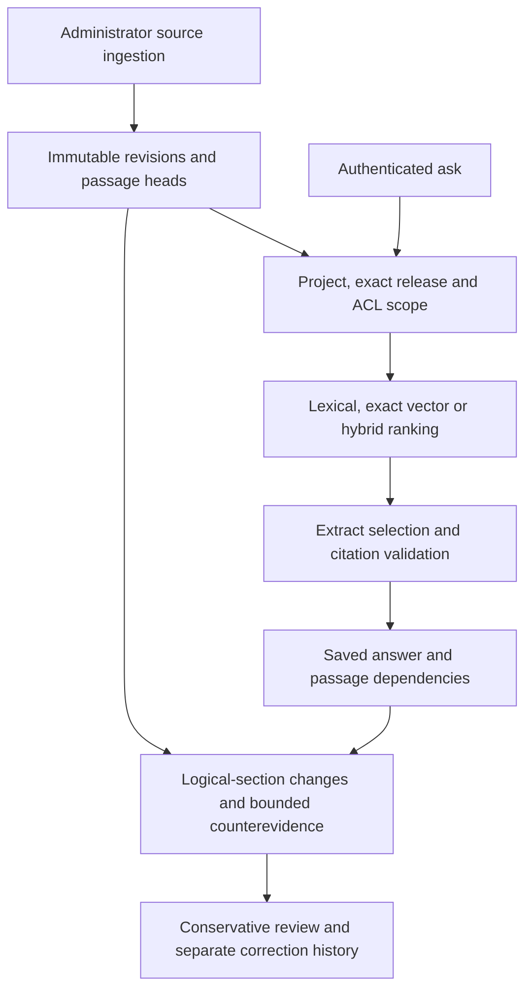

# ReleaseLens — documentation answers tied to the right release, with a review trail when sources change

[](https://github.com/Jill-Vekariya/ReleaseLens/actions/workflows/ci.yml)

[](LICENSE)

**[Try the browser demo](https://jill-vekariya.github.io/ReleaseLens/)** · [Retrieval study](docs/V3_REPORT.md) · [Migration challenge](docs/CHALLENGE_V1.md) · [Architecture](docs/ARCHITECTURE.md)

## The problem

Ask a documentation chatbot how to configure something and it will happily quote the docs for a version you are not running, or quote a passage that mentions your keyword but does not actually answer the question. Worse, when the docs change next week, the answer it gave you last week is now silently wrong. ReleaseLens is a retrieval system that scopes every answer to a project, an exact release and the user's access rights, keeps the exact cited text immutable, and flags saved answers for review when the passages they depend on change.

## What I built

- **Scope before ranking:** project, exact release and ACL filters are applied before top-k retrieval, so a restricted passage can never leak into the candidate set.
- **Three ranking modes:** BM25 on SQLite, text ranking with exact pgvector search on PostgreSQL, and a hybrid. The default encoder is a deterministic test double; a pinned pretrained encoder is opt-in.
- **Immutable citations:** each saved answer stores its exact extracts and passage dependencies. Later edits create a correction history; they never overwrite the original.
- **Change impact analysis:** when a source is re-ingested, logical-section diffs find every saved answer whose cited passage changed and queue it for review, while formatting-only edits leave answers untouched.
- **Evidence-sufficiency review packets** that separate "the citation is real" from "the citation supports the answer".

## Results

| Study | Result | Scope |
| --- | --- | --- |
| [Retrieval study](docs/V3_REPORT.md) | 14 source snapshots, 534 passages, frozen 70-question set; pretrained retrieval compared with lexical baselines | AI-proposed labels, no human accuracy labels yet |
| [Migration challenge](docs/CHALLENGE_V1.md) | BM25 won the small dev comparison; an exact quotation still failed to support the asked answer | Shows citation validity and answer support are different things |
| Test suite | 185 Python tests and 16 browser-engine tests passing in CI | PostgreSQL-only cases run in CI, skipped locally without a database |

## Where this applies

- **Developer-tools and API companies:** support bots for versioned SDKs need release-exact answers; "latest docs" is the wrong answer for someone pinned to 2.x.
- **Regulated industries:** pharma, finance and legal teams need to know which answers were affected when a controlled document changes, and need the original answer preserved for audit.
- **Internal knowledge bases with access control:** filtering by ACL after retrieval both loses recall and leaks document identifiers; doing it first is the correct design.

## Architecture



[Architecture](docs/ARCHITECTURE.md) · [Models and setup](docs/MODELS.md) · [Evaluation protocol](docs/EVALUATION.md)

## Quick start

Requires Python 3.12. No model API key needed.

```bash
git clone https://github.com/Jill-Vekariya/ReleaseLens.git
cd ReleaseLens
python3.12 -m venv .venv
.venv/bin/python -m pip install -r requirements.lock
.venv/bin/python -m pip install --no-deps -e .
.venv/bin/python -m releaselens --demo        # http://127.0.0.1:8000
```

Try this: save the synthetic timeout answer, change its fact as Administrator, revalidate, and inspect the preserved original next to the correction. Then make a formatting-only edit and see that nothing is flagged. Docker with PostgreSQL: [OPERATIONS.md](docs/OPERATIONS.md). Tests: `.venv/bin/python -m pytest -q`. Everything else: [reference guide](docs/REFERENCE.md).

## What I learned

<!-- Rewrite these in your own words before you point a recruiter here. Short, specific, first person. -->

- A citation that exists is not a citation that supports the answer. The migration challenge made that concrete.
- Exact release equality is stronger than putting the version number in the prompt and hoping.
- Document-level invalidation creates false positives; section-level dependencies are the right granularity.

## Limits

- Retrieval scores use AI-proposed labels; independent human accuracy labels are not recorded yet.
- One API process serialises transactions; multi-worker consistency and ANN scale are open.
- Changed public prose requires manual review; arbitrary contradictions are not adjudicated automatically.
- The optional model provider cannot decide access or execute tools, by design.

[Evaluation protocol](docs/EVALUATION.md) · [Security](docs/SECURITY.md) · [Full reference](docs/REFERENCE.md)


## License

[MIT](LICENSE). Upstream documentation snapshots keep their own licenses, hashes and attribution.
