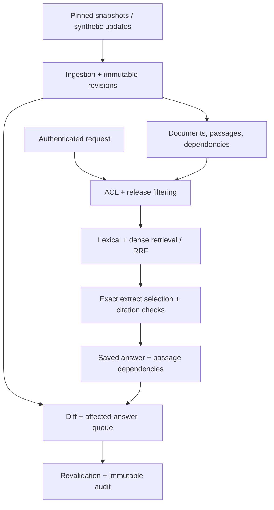

# ReleaseLens

**Version-scoped evidence, saved-answer dependencies, and documentation change intelligence.**

ReleaseLens asks a concrete question: **when documentation changes, which saved answers need review?** It preserves immutable evidence, records answer-to-passage dependencies, detects source revisions, and produces a review trail without overwriting the original answer.

This repository is an **AI-assisted, verified v0.1 engineering implementation**, not a completed production system. Human implementation and independent review are still pending; see [ownership](docs/OWNERSHIP.md). The current runnable mode uses exact extracts and deterministic feature-hashed vectors. **Feature hashing is not learned semantic search.** Optional learned-encoder and OpenAI-compatible extract-selection adapters are included; their live quality has not been evaluated.

## Start locally

Requires Python 3.12. No personal API key is needed for the synthetic demo.

```bash
python -m venv .venv
# Linux/macOS:
source .venv/bin/activate
# Windows PowerShell instead: .venv\Scripts\Activate.ps1
python -m pip install -r requirements.lock
python -m pip install --no-deps -e .
python -m releaselens --demo
```

Open **http://127.0.0.1:8000**. API reference: **http://127.0.0.1:8000/docs**. The demo is loopback-only. Changing the synthetic role changes the server-selected identity; this is explicitly a teaching sandbox.

The interface contains Ask, Version Comparison, an Evidence Inspector, Change Intelligence, Evaluation, and Access Boundaries. It calls the backend; results are not hardcoded UI responses. There are no frontend package dependencies or external UI assets.

### Run the signature scenario

1. Select **Administrator** and open **Change intelligence**.
2. Select **Save current answer**. The original fixture says 30 seconds.
3. Select **Change timeout value**. It toggles 30 ↔ 60; dependent answers become pending.
4. Select **Revalidate** on the old answer. The synthetic fact change is confirmed stale, and a separately saved correction is linked.
5. Inspect **History**, the source diff, and preserved old evidence.
6. Save the current answer, apply **Formatting-only update**, and verify it stays unaffected.
7. Switch to **Reader**, open **Access boundaries**, and probe the restricted synthetic canary. Protected evidence is withheld by the backend.

Existing demo edits survive restarts. For a clean run, use a different database path, e.g. `DATABASE_URL=sqlite:///./fresh-demo.db python -m releaselens --demo` on Linux/macOS. Do not delete an existing database containing work you want to retain.

## Verified upstream corpus

Four licensed documentation snapshots are bundled. Each includes a release tag, resolved immutable Git commit, raw SHA-256, license SHA-256, commit timestamp, canonical URL, and adjacent original MIT license. These are selected pages, **not complete project documentation**.

| Project | Releases | Selected source |
| --- | --- | --- |
| Pydantic | 1.10.15, 2.10.4 | Model configuration |
| SQLAlchemy | 1.4.54, 2.0.36 | Core connections and transactions |

```bash
# Ingest the already verified local snapshots; does not require network:
python scripts/ingest_sources.py
# Optional: repeat upstream tag resolution and downloads (requires network):
python scripts/fetch_sources.py
```

The ingestion script rechecks source and license hashes. In production use, a trusted source curator controls ingestion. The HTTP API accepts administrator-authored provenance assertions; it does not independently fetch or attest arbitrary upstream URLs. Synthetic fixtures use example.invalid URLs and never masquerade as upstream quotations.

## Architecture



Python/FastAPI serves the API and a buildless HTML/CSS/JavaScript interface. SQLAlchemy supports SQLite for the verified local path and PostgreSQL for the provisioned deployment path. PostgreSQL uses pgvector exact search and full-text ranking; SQLite uses in-process dot products and BM25. These are different backends and must be benchmarked separately.

The schema models documents, append-only revisions, immutable passages, saved answers, passage dependencies, document changes, and revalidation reviews. Document identity is `(project, release, document_key)`. Logical passage keys connect snapshots; physical passage UUIDs are immutable citation targets. Review requests against the same evidence heads are idempotent. Read the detailed [architecture and decisions](docs/ARCHITECTURE.md).

## Evidence and change semantics

- Every claim is an exact substring of an authorized, release-correct passage. Existence, source metadata, immutable quote, hashes, project/release, quarantine state, and claim membership are checked deterministically.
- This proves **extract membership**, not semantic relevance, completeness, or general entailment.
- Wrong-release evidence from an unfiltered experimental baseline causes abstention at generation time.
- Formatting-only normalization covers line endings, trailing spaces, and extra blank runs. It preserves case and code indentation. Ambiguous formatting changes conservatively require review.
- Explicit synthetic fact changes can demonstrate `confirmed_stale`. Changed real prose is conservatively `manual_review_required`; missing evidence yields `insufficient_evidence`.
- The current conflict detector compares explicit synthetic fact assertions. General natural-language contradiction detection is pending.
- Dependencies are searched across historical revisions, so an intervening formatting change does not sever impact tracking.
- A wholly new passage can contradict an old answer without touching its cited passages; detecting that wider impact is not implemented.

## Evaluation

```bash
python -m pytest -q
python -m releaselens.evaluate
python -m ruff check .
python -m ruff format --check .
node --check web/app.js
```

Actual outputs are in [evaluation/results.json](evaluation/results.json), with per-query rankings, dataset hash, measured latency, confidence intervals, and explicit unmeasured fields. The runner evaluates 24 AI-authored synthetic development questions, six synthetic change scenarios, and eight restricted-retrieval probes. **None are claimed human-reviewed.** Unit/security tests cover additional edge cases.

The A/B/C/D retrieval comparisons are controlled **demonstrations**, not evidence that the heuristic reranker or hashing approach improves real retrieval. Reranking remains available only as an experimental baseline because no independently reviewed corpus justifies using it by default. The default version mode uses release filtering and hybrid retrieval without the heuristic.

The final 300–500-question target, separate tuning and held-out families, natural-language answer accuracy, calibrated abstention precision, learned reranker ablations, live inference cost, and load testing remain pending. See [evaluation protocol](docs/EVALUATION.md).

## PostgreSQL and Docker

```bash
python scripts/configure.py
docker compose up --build --wait
```

Open **http://127.0.0.1:8080**. The generated `.env` contains private random local credentials; enter the appropriate token through the UI's **API token** control. Docker mode uses real bearer authentication and ignores synthetic role headers. Ingest data inside the backend container:

```bash
docker compose exec backend python scripts/ingest_sources.py
```

This starts PostgreSQL/pgvector, runs Alembic, starts FastAPI, and serves the UI through Nginx. PostgreSQL is not exposed on the host. The named volume persists database records.

**Docker and PostgreSQL execution are unverified in the build environment because Docker/PostgreSQL runtimes are absent.** CI has separate unit, PostgreSQL integration, and Compose startup jobs. They are prepared, **not claimed to have run on GitHub**. Images use release tags rather than immutable digests; pin verified digests before a reproducibility-sensitive deployment.

## Optional inference

The default run makes no model-provider requests. To enable a learned 384-dimensional encoder, install `.[ml]`, set `EMBEDDING_MODEL` and an immutable 40-character `EMBEDDING_REVISION`, and use a fresh corpus database for ingestion. A model change requires explicit reindexing; mixed model spaces are not silently searched.

For an interchangeable remote or local OpenAI-compatible **extract selector**, set `GENERATOR_MODE=compatible`, `LLM_BASE_URL`, `LLM_MODEL`, and optionally `LLM_API_KEY`. It uses `/chat/completions`, no tools, a bounded output, and exact-evidence validation. Unsupported text/IDs fail closed to abstention. Provider usage is retained; cost stays unknown without pricing configuration. The adapter is mock-tested, **not live-provider verified**. Paid inference must be an explicit user choice.

## Security and deployment status

Authorization is enforced before candidate scoring, at direct citation access, saved-answer access, dependency inspection, and review history. Answers are owner-private, including for administrators. No result cache is used, avoiding a premature cache scope contract. No model decides permissions. The prompt-injection quarantine is a demonstrative heuristic with documented bypass limitations; it does not prove comprehensive injection resistance.

Read [security design](docs/SECURITY.md), [verification checklist](docs/STATUS.md), [deployment blockers](docs/DEPLOYMENT.md), and the [interview/demo guide](docs/INTERVIEW.md).

No public GitHub repository, CI run, or hosted application URL has been created. GitHub is not connected. A full Python/PostgreSQL hosting account and cost decision are also needed. Sites' Worker runtime does not execute this Python backend; publishing a static frontend would not complete the requested system. Browser interaction was not verified because the managed preview supervisor could not locate Python. HTTP lifecycle, schema, frontend syntax, and backend workflows were tested in-process.

## Repository map

```text
releaselens/       models, ingestion, retrieval, generation, API, revalidation, evaluation
web/              responsive API-connected workbench
data/upstream/    four pinned source snapshots, manifests, and original licenses
tests/            lifecycle, authorization, citations, sources, migration, provider, PG tests
alembic/          explicit initial schema and PostgreSQL vector/FTS setup
evaluation/       candidate development questions and actual diagnostic outputs
scripts/          snapshot fetching/ingestion, configuration, verification helpers
docs/             architecture, status, security, ownership, evaluation, deployment, interviews
.github/workflows/ unit, PostgreSQL, and Compose CI jobs
```

License: MIT for ReleaseLens code and synthetic examples. Upstream licenses and attributions remain adjacent to their snapshots. No confidential or personal corpus data is included.
