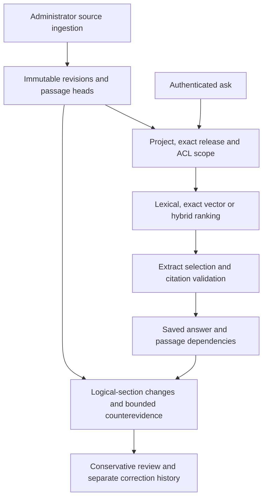

# ReleaseLens

**Release-scoped evidence and saved-answer review when documentation changes.**

ReleaseLens stores immutable documentation revisions, answers with exact cited extracts and records passage dependencies. Later updates queue affected answers for review while preserving the original, review history and any separate correction. A citation can be authentic yet insufficient to answer the question; the implementation and experiments keep that distinction visible.

[Browser demo](https://jill-vekariya.github.io/ReleaseLens/) · [Interview walkthrough](docs/INTERVIEW.md) · [Measured retrieval report](docs/V3_REPORT.md) · [Migration challenge](docs/CHALLENGE_V1.md)

The browser edition uses pinned source snapshots and synthetic role/change scenarios with local browser state. FastAPI/SQLite/PostgreSQL is a separate application; GitHub Pages does not run those containers. [Standalone demo source](demo/README.md).

## Architecture



Scope precedes top-k selection. SQLite uses local BM25/exact vectors; PostgreSQL uses text ranking/exact pgvector, with separate evaluation requirements. The default hash-384 encoder is a deterministic test double, not a learned semantic model. Optional pinned pretrained retrieval and compatible model extract selection are opt-in. [Architecture](docs/ARCHITECTURE.md) · [Models/setup](docs/MODELS.md).

## Quick start: deterministic local demo

Requires Git, Python 3.12 and dependency-download access. Linux commands:

```bash
git clone https://github.com/Jill-Vekariya/ReleaseLens.git
cd ReleaseLens
python3.12 -m venv .venv
.venv/bin/python -m pip install -r requirements.lock
.venv/bin/python -m pip install --no-deps -e .
.venv/bin/python -m releaselens --demo
```

Open `http://127.0.0.1:8000`. No model API key is needed. Demo roles work only in explicitly enabled loopback demo mode; they are not production authentication. Windows uses `py -3.12` and `.venv\Scripts\python.exe`. For another clean demonstration, select an unused SQLite `DATABASE_URL`; preserve existing databases and saved answers.

Try: save the synthetic timeout answer → change its explicit fact as Administrator → revalidate → inspect the preserved original and separate correction. Then apply a formatting-only update and inspect that it remains unaffected. [Full walkthrough](docs/interview/README.md).

For authenticated Docker/PostgreSQL, use [OPERATIONS.md](docs/OPERATIONS.md). A new installation runs `python scripts/configure.py` once, then `docker compose up --build --wait` and `docker compose exec -T backend python scripts/ingest_sources.py`. Existing installations reuse credentials/volumes. The local UI is `http://127.0.0.1:8080`; a public Python backend remains unprovisioned.

## Evidence and verification

| Evidence | Actual observation | Limit |
| --- | --- | --- |
| [Expanded retrieval study](docs/V3_REPORT.md) | 14 snapshots/534 passages; frozen 70-question AI-proposal set; pretrained retrieval compared with baselines | No trained model weights or independent human accuracy labels |
| [Migration challenge](docs/CHALLENGE_V1.md) | Separate 24-question diagnostic; BM25 won the small dev comparison; transferred gate answered both proposed unsupported validation questions | Exact citation validation passed despite missing sufficient inputs; eight reserved questions stayed unscored |
| [Stage 4 local review](docs/INTERVIEW.md) | 40 selected lifecycle/access/provider/concurrency tests passed | Default extraction, mocked provider or loopback stub; no new external inference |

From the installed checkout:

```bash
.venv/bin/python -m pytest -q
.venv/bin/python -m ruff check .
.venv/bin/python -m ruff format --check .
.venv/bin/python -m scripts.review_benchmark audit --dataset challenge --file evaluation/local/my-split-audit.json
python scripts/check_links.py
```

Use a new audit output path. PostgreSQL-only tests require their configured database and are skipped without it; local SQLite passes are not PostgreSQL execution. [Evaluation protocol](docs/EVALUATION.md) · [Review packet](docs/review/challenge-dev-packet.html) · [Operations](docs/OPERATIONS.md).

## Correctness contract and limits

- Authorization, project/release identity and immutable quotation are checked independently of model output. Exact extract containment proves membership, not relevance, completeness or general entailment.
- Logical-section changes find historical citations across formatting revisions. Explicit synthetic fact changes may be confirmed stale; changed public prose requires manual review. Corrections do not overwrite old answers.
- Structured public counterevidence covers a bounded case. Optional prose-review candidates are disabled by default; arbitrary contradictions are not automatically adjudicated.
- One API process serializes transactions. Multiworker consistency, organization tenancy, ANN scale and independent semantic evaluation remain open.
- Optional provider responses use a 250,000-byte pre-append budget and identity encoding. Phase timeouts/cooperative elapsed checks are not hard preemption; failed-call usage/cost may remain unknown. The provider cannot decide access or execute tools.

Learned retrieval/gate scores use AI-proposal labels and consumed diagnostic sets. They are not independent answer accuracy, proof of safe abstention or production-user outcomes. [Impact policy](docs/IMPACT_REVIEW.md) · [Security](docs/SECURITY.md) · [Current status](docs/CURRENT_STATUS.md).

## Ownership, next work and license

Requirements/access decisions and AI implementation/review are distinguished in [OWNERSHIP.md](docs/OWNERSHIP.md). Personal coding/reproduction and human labeling require actual confirmed work; prepared answers do not complete those exercises.

Next: genuine source-grounded review, new prospective questions and backend-specific consistency/operations validation. Repository code uses the existing [MIT license](LICENSE); upstream snapshots retain adjacent licenses, hashes and attribution. No new license is selected here.
