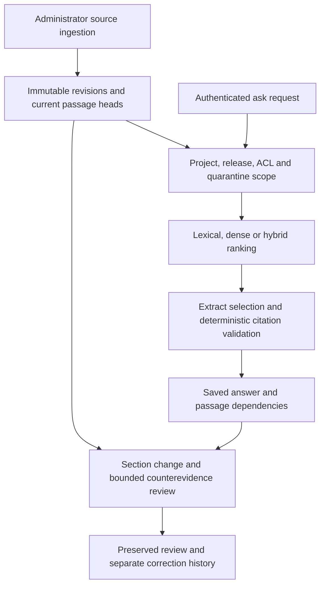

# ReleaseLens — technical interview guide

Stage 4 review: 27 October 2026. These are implementation-grounded rehearsal notes. Personal ownership remains a separate record in [OWNERSHIP.md](OWNERSHIP.md); earlier interview resources are retained below.

## Evidence boundary

| Item | Status and scope |
| --- | --- |
| Reviewed implementation | **VERIFIED by inspection:** base `89728fcef3b27f1f02521eb5f88d50690bcb0930` plus existing, uncommitted Stage 1/3 provider-stream changes and their tests/README correction. The base commit alone does not identify the local source. |
| Stage 4 focused checks | **VERIFIED locally:** 40 tests passed for source-change lifecycle, access control, compatible-provider boundaries and concurrent requests. The provider HTTP test uses a local stub, not external model inference. |
| Earlier Stage 3 full suite | Recorded 178 passed, two PostgreSQL-only skips. This was local Python execution, not new PostgreSQL/container/CI execution. |
| Quality/deployment | The browser demo is separate from FastAPI/PostgreSQL. Human semantic/relevance ground truth is not established; challenge labels are AI-reviewed proposals. Fresh public backend deployment remains **UNVERIFIED**. [Challenge limits](CHALLENGE_V1.md), [status](STATUS.md). |

## 60-second pitch

ReleaseLens answers questions against a specific documentation release and keeps saved answers reviewable when sources change. It stores immutable revisions, scopes retrieval by project, release and access classification, and validates exact quoted extracts before saving answer-to-passage dependencies. Later ingestion compares logical sections and queues affected answers while preserving the old answer. Revalidation can confirm changes to explicit synthetic facts; changed public prose requires manual review rather than an invented correctness judgment. Optional learned retrieval and model-backed extract selection are separate from the deterministic default. The central engineering lesson is that a valid citation proves membership and provenance, not that an answer is relevant, complete or semantically supported. The repository demonstrates that distinction with lifecycle tests and diagnostic failures, while keeping independent human evaluation and production backend claims open.

## Three-minute walkthrough

**0:00–0:40 — Why release and identity are data constraints.** Open [api.py](../releaselens/api.py) and [retrieval.py](../releaselens/retrieval.py). Authentication creates a principal independently of prompt text. Current revision, project, classification and release filter the retrieval corpus before ranking. Putting a release string in a prompt cannot replace this boundary. The default `HashEmbedder` is a deterministic test double, not a learned semantic model.

**0:40–1:20 — Ask and save.** Trace `POST /api/ask` into [service.ask](../releaselens/service.py). Ranking supports lexical, dense and hybrid paths, with backend-specific implementations. The default generator selects extracts; an optional compatible provider may select only supplied passage IDs and exact substrings. `validate_citations` checks immutable citation fields, authorization, release and claim containment. A saved answer records dependencies on actual passage IDs; it does not overwrite source history or infer technical migration advice.

**1:20–2:10 — Change and review.** In [ingestion.py](../releaselens/ingestion.py), show administrator-only updates with expected-revision checks, immutable revision rows, normalization and logical section keys. Explain why the implementation follows historical citations after a formatting-only update: otherwise the next technical update could miss an old saved answer. `revalidate` follows current logical heads and fingerprints evidence for idempotent reviews. Synthetic explicit fact changes can become `confirmed_stale`; arbitrary changed prose becomes `manual_review_required`. Corrections are separate answers.

**2:10–3:00 — Failure and limits.** Run the lifecycle, citation, access and provider-stream tests below. Show a fabricated extract being rejected and an old answer preserved after correction. The migration challenge's transferred relevance gate still answered two proposed unsupported validation cases; exact citations passed. Explain why missing production input records cannot be recovered by lexical overlap or a relevance threshold. End with actual human labels, representative new questions, backend-specific validation and multi-worker concurrency as future work, without calling proposal-based scores independent accuracy.

## Architecture



Model selection does not decide access or citation validity. The browser edition uses its own local state and does not host the Python backend shown here.

## One end-to-end execution trace

Trace a saved synthetic `request_timeout` answer through a technical update:

| Step | Path and symbol | Behavior |
| --- | --- | --- |
| 1 | [api.py](../releaselens/api.py) · `create_app`, nested `principal`, `session_dep`, `ask_route` | Resolve an authenticated user/role and a database transaction. Demo-role headers are allowed only in explicitly enabled loopback demo mode. |
| 2 | [retrieval.py](../releaselens/retrieval.py) · `rank` | Scope authorized non-quarantined passages from current revisions to project/release before choosing top-k. PostgreSQL uses its separately implemented `postgres_rank`. |
| 3 | [generation.py](../releaselens/generation.py) · `ExtractiveGenerator.select`; [service.py](../releaselens/service.py) · `ask`, `validate_citations` | Select extracts, verify immutable citation identity/quote/release and claim containment, then save `Answer` and `Dependency` rows. |
| 4 | [ingestion.py](../releaselens/ingestion.py) · `ingest`, `normalize` | Administrator submits current `expected_revision`. Create a new revision/passages and advance the document head without rewriting cited old passages. |
| 5 | [ingestion.py](../releaselens/ingestion.py) · `ingest`; [impact.py](../releaselens/impact.py) · `queue_new_public_counterevidence` | Queue answers linked to changed logical sections across historical revisions; bounded public synthetic-fact counterevidence is a separate path. |
| 6 | [service.py](../releaselens/service.py) · `owned_answer`, `revalidate`; [impact.py](../releaselens/impact.py) · `review_fingerprint` | Recheck answer ownership and current dependency access, follow current logical heads and reuse an existing same-evidence review rather than duplicate it. |
| 7 | [service.py](../releaselens/service.py) · `revalidate` | An explicitly supported synthetic fact change yields `confirmed_stale`; retain the original and save any correction separately. Public prose changes require manual review instead. |

The complete regression entry point is [test_end_to_end_stale_correction_preserves_history](../tests/test_lifecycle.py). Trace that synthetic case before discussing unstructured public sources.

## Decisions and alternatives

| Implemented decision | Trade-off | When a different choice becomes justified |
| --- | --- | --- |
| Exact extract generation; [generation.py](../releaselens/generation.py), [service.py](../releaselens/service.py) | Limited fluency; an exact extract can still fail to answer the question. | A separately evaluated fluent generator with claim-level entailment, abstention and attack labels. |
| ACL/release filtering before scoring; [retrieval.py](../releaselens/retrieval.py) | More backend-specific query work than global top-k then filtering. | A different index must preserve equivalent preselection access guarantees and recall; prompt instructions are insufficient. |
| Immutable revisions and logical keys; [ingestion.py](../releaselens/ingestion.py) | More storage and dependency bookkeeping. | Explicit retention/archival policy with referential integrity, rather than mutating cited historical bytes. |
| SQLite local path; process-local asynchronous transaction lock in [api.py](../releaselens/api.py) | Serializes local transactions and is not a distributed concurrency protocol. | PostgreSQL and cross-worker conflict/locking tests for real concurrent workload requirements. |
| Manual review for changed public prose; [service.py](../releaselens/service.py) | Conservative queue and human work; does not automatically resolve arbitrary contradiction. | Reviewed contradiction/entailment data and a prospectively evaluated classifier. |
| 250,000-byte provider accumulator, identity encoding and elapsed checks; [generation.py](../releaselens/generation.py) | Compatibility loss for compressed responses; synchronous blocking cannot be forcibly preempted. | Test a required real provider before adding bounded decompression or cancellable process isolation. |

## Challenging questions and accurate answers

**Does an exact citation prove correctness?** No. It proves that a supplied extract matches the authorized immutable evidence and release. The extract can be irrelevant, incomplete or unable to determine a value absent from the source. This distinction is enforced/documented by `validate_citations` and the [migration challenge](CHALLENGE_V1.md).

**What does hybrid mean on each backend?** SQLite ranks a small scoped corpus using local BM25 and exact vector scores with reciprocal-rank fusion. PostgreSQL has exact pgvector distance and PostgreSQL text ranking; that lexical component is not BM25. A SQLite result is not a PostgreSQL benchmark. See [retrieval.py](../releaselens/retrieval.py) · `rank`, `postgres_rank`.

**Is the default encoder a trained embedding model?** No. `HashEmbedder` hashes token counts into normalized 384-dimensional vectors. The opt-in `SentenceEmbedder` loads a pinned pretrained model without remote code; integration is not training. Do not describe default hash retrieval as demonstrated semantic understanding.

**Why does a formatting-only update need historical dependency handling?** An answer may still cite revision 1 after equivalent revision 2 is created. Revision 3's technical change must find that old citation by logical section. Following only revision 2 would miss it. [The regression](../tests/test_lifecycle.py) is `test_formatting_does_not_invalidate_and_next_update_still_finds_old_dependencies`.

**Can a newly added contradiction be missed?** Dependency-only invalidation can miss sources the answer never cited. The public fact-counterevidence path covers a narrow structured setting; the optional prose candidate path is not a general semantic contradiction oracle. Arbitrary new contradictory prose remains a confirmed scope limitation requiring human review and further evaluation.

**What if a saved answer owner's role is downgraded?** Reading/revalidating the answer rechecks access to dependencies, in addition to ownership. A historical successful read is not permanent authorization. See [test_production_same_identity_downgrade_cannot_read_saved_private_answer](../tests/test_security.py).

**What happens when the compatible provider times out or invents an extract?** It becomes an explicit generation failure/abstention rather than accepted prose. Failed-call usage/cost stay unknown unless retained. Phase timeouts and checks between response chunks do not impose hard preemption of every synchronous transport. [Provider tests](../tests/test_generation.py).

**Is the challenge's frozen gate independently validated?** No. It was transferred without recalibration to a small AI-proposal diagnostic, and two proposed unsupported validation questions were still answered. Human-reviewed labels remain missing and the old inspected test is consumed. The recorded failure is evidence against treating citation membership or a transferred relevance threshold as answerability proof.

## Supported debugging examples

| Case | Established evidence | Interpretation limit |
| --- | --- | --- |
| Provider stream adaptation | The initial Stage 1 use of `iter_raw` failed existing mock-response tests with `StreamConsumed`; bounded `iter_bytes` corrected that path. Stage 3 removed fixed-size coalescing so tiny chunks reach elapsed checks promptly. [generation.py](../releaselens/generation.py), [stream/tiny-chunk tests](../tests/test_generation.py). | The original launcher/failure narrative is retained in prior stage reports; do not invent a fresh raw transcript or provider-compatibility claim. |
| Change after formatting revision | [Lifecycle tests](../tests/test_lifecycle.py) retain old answer dependencies and find later changed logical sections. | This establishes dependency mechanics, not a general language-change detector. |
| Concurrent local requests | [test_concurrent_requests_complete_without_cross_thread_dependency_lock_errors](../tests/test_concurrency.py) checks 50 ASGI requests and distinct saved IDs using the async dependency lock. | In-process success is not multi-worker database validation or a service throughput result. |
| Citation-valid but unsupported diagnostic answers | [CHALLENGE_V1.md](CHALLENGE_V1.md) records two unsupported validation cases answered under the transferred policy. | Proposed labels require independent review; the narrower unsupported-answer count omits other semantic errors. |

If a new answer is missing, inspect scope/authorization, current heads/quarantine, retrieval scores and generator status in that order. Missing source facts, ranking failure and provider failure are different hypotheses; use the saved metadata before choosing a cause.

## Limits and useful future work

- Confirmed boundaries: small-corpus local ranking, explicit structured-fact semantics, limited injection-marker quarantine and a process-local transaction lock. These do not certify production security or general contradiction detection.
- **UNVERIFIED:** independent relevance/semantic labels, representative new-query generalization, fresh PostgreSQL execution on this host, live external-provider compatibility of the patch and a hosted Python backend.
- Prioritize genuine source review and new prospective queries, then backend-specific concurrency/operational validation. Adding a model or vector index does not remove the evaluation gap.

## Personal contribution and AI assistance

| Claim | Existing evidence | Confirmation required |
| --- | --- | --- |
| Specification/quality requirements and recorded owner publication action | [OWNERSHIP.md](OWNERSHIP.md) distinguishes owner requirements/merge from AI code and labels. | Confirm exact personal actions before using first-person wording. |
| Implementation, diagnostic experiments and notes | AI-assisted; source/results do not establish independent human authorship or annotation. | Actual personally authored commits and independently reproduced results. |
| Personal two-section lifecycle exercise | Still pending in the ownership record. | Complete and explain the exercise personally; generated tests elsewhere do not complete it. |
| Users, business savings, production ownership or model training | **UNVERIFIED; do not claim from this project.** | Separate supporting facts if they exist. |

## Practical rehearsal checklist

Use Python 3.12 and the pinned environment from [README](../README.md). Run from the repository root:

```bash
git rev-parse HEAD
git status --short
git diff HEAD -- releaselens/generation.py tests/test_generation.py
.venv/bin/python -m pytest -q tests/test_lifecycle.py tests/test_security.py tests/test_generation.py tests/test_concurrency.py
```

For a separate local demonstration, set a new `DATABASE_URL` pointing to an unused SQLite file and run `.venv/bin/python -m releaselens --demo`. This is explicitly loopback demo identity mode. Retain existing databases; do not present demo-role headers as production authentication. PostgreSQL and learned-encoder reproduction have separate prerequisites in [OPERATIONS.md](OPERATIONS.md) and [MODELS.md](MODELS.md).

- [ ] Trace one saved synthetic answer through update/review/correction without mutating its original payload.
- [ ] Explain scope before top-k, owner/dependency reauthorization and exact extract validation.
- [ ] Demonstrate formatting-only, missing-passage, changed-prose and changed-synthetic-fact outcomes separately.
- [ ] Predict a fabricated extract, compressed stream and tiny-chunk timeout test before execution.
- [ ] Distinguish hash embedding, pretrained inference, reranking, training and human evaluation.
- [ ] Open the diagnostic failure and explain why citations alone did not establish answerability.
- [ ] Confirm one personal contribution with actual source/output rather than a rehearsed authorship story.

## Earlier interview and ownership package — retained

Start with [overview, architecture, setup, five-minute demo and decisions](interview/README.md).

- [42 project-specific questions and accurate answers](interview/QUESTION_BANK.md)
- [Unsolved coding, backend, ML-evaluation and system-design exercises; four-week schedule](interview/PRACTICE.md)
- [Source walkthrough and understanding checklist](interview/WALKTHROUGH.md)
- [Measured benchmark and error analysis](BENCHMARK_REPORT.md)
- [Actual correctness failures and AI final review](FINAL_AI_REVIEW.md)
- [Operational setup, backup, restore and rollback](OPERATIONS.md)
- [Implemented limits and proposed scale architecture](SCALE.md)
- [Contribution record and preserved ownership exercise](OWNERSHIP.md)

These are AI-assisted learning materials, not evidence of independent user authorship or interview outcomes. Résumé claims must describe the work you actually understood, modified and verified. No users, business savings, production traffic or human annotation are invented.

The current [v3 interview update](interview/V3_UPDATE.md) includes the expanded experiment, current measured limits, actual local inference failure and conditional résumé templates. Earlier pilot/test counts remain historical.

## Migration challenge discussion

Read [CHALLENGE_V1.md](CHALLENGE_V1.md) for a useful interview failure case: BM25 beat the pretrained approaches on the small dev diagnostic, while a previously frozen relevance threshold answered two new unsupported validation questions. Explain why relevance scores and exact citations do not prove that missing production input records exist, why a transferred threshold is not recalibration, and why inspecting these failures forbids treating them as a future untouched test. No human correctness score or neural training is claimed. Use [RESUME.md](RESUME.md) for the current branch and handoff.
