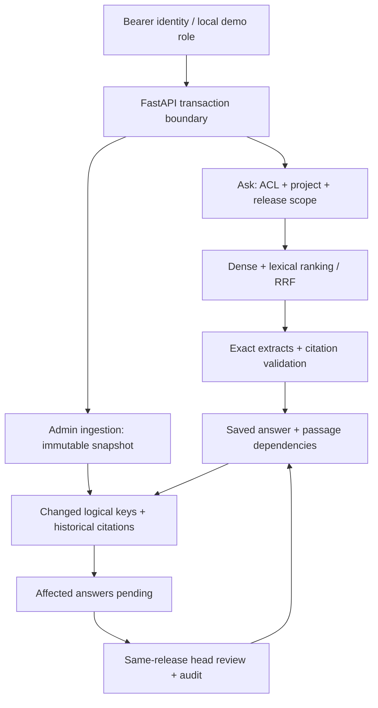

# ReleaseLens interview and ownership package

Prepared on 2026-10-15. All material in this package is AI-assisted. No independent user implementation, code review, annotation, or ownership exercise completion is recorded. Reading and rehearsing this package does not establish independent authorship.

Use this guide for the narrative and demonstration, [Question bank](QUESTION_BANK.md) for answered technical questions, [Practice](PRACTICE.md) for unsolved exercises and a four-week schedule, and [Code walkthrough](WALKTHROUGH.md) for source-level understanding checks. The original ownership exercise in [OWNERSHIP.md](../OWNERSHIP.md) remains unsolved.

## What to say in 30 seconds

“ReleaseLens is an AI-assisted engineering project about maintaining technical answers when documentation changes. It retrieves evidence within a project, software release, and access boundary, saves immutable citations and passage dependencies, and queues affected answers for review after source updates. It preserves the old answer and records a separate correction and review history. The current answer mode uses exact extraction; general semantic correctness and learned-model quality still need independent evaluation.”

For a longer explanation, add the concrete example: an answer cites a synthetic request-timeout policy of 30 seconds; the policy changes to 60; the saved answer becomes pending; revalidation records `confirmed_stale` and links a correction. Say **synthetic structured fact**, because real prose changes are sent to manual review.

## Evidence and claim boundaries

The latest session verification supersedes older “Docker/browser/GitHub unavailable” statements in the initial docs. Those statements describe the earlier build environment, not the subsequent Windows verification. This package records the following evidence supplied by the project verification session; it does not claim a separate human review.

| Area | Executed or observed | Remaining limit |
| --- | --- | --- |
| Windows automated suite | 101 passed, one PostgreSQL test skipped in the latest local invocation | PostgreSQL was tested separately; do not count the skip as a pass |
| PostgreSQL and Docker | Actual PostgreSQL/pgvector, Alembic, FastAPI and Nginx startup; separate PostgreSQL integration and real HTTP source ingestion/change/revalidation/ACL checks | Functional execution is not load testing or production readiness |
| Browser | Edge checks for ask, comparison, roles, change lifecycle, evaluation and mobile layout; no JavaScript errors observed | These checks do not cover every browser or accessibility requirement |
| Repository/CI | Private repository at <https://github.com/Jill-Vekariya/ReleaseLens>; initial CI successful | CI for the latest fixes must be checked on the exact commit before citing it |
| Sources | Four pinned, licensed selected documentation snapshots | Selected pages are not full Pydantic/SQLAlchemy coverage |
| Retrieval/generation | Hash encoder plus lexical retrieval; deterministic exact extraction | Feature hashing is not learned semantic search; no live LLM result claimed |
| Learned encoder | Pinned CPU MiniLM execution verified; pilot results in BENCHMARK_REPORT.md | Execution and AI-label pilot results do not establish independent human quality |
| Evaluation/ownership | 24 AI-authored development questions, six controlled change cases, eight restricted-retrieval probes | No human-reviewed held-out accuracy, independent user implementation, published research novelty or production impact |

The intended learned-model pin is `sentence-transformers/all-MiniLM-L6-v2@1110a243fdf4706b3f48f1d95db1a4f5529b4d41`. The runtime report establishes execution. Independent relevance labels are still needed to establish quality. Consult the latest verification artifacts and CI commit before using numerical claims in an interview.

## Architecture you should explain from memory



One modular FastAPI service serves the buildless web UI and API. SQLAlchemy stores documents, append-only revisions/passages, answers, dependencies, changes, and reviews. A document is identified by `(project, release, document_key)`. Its head moves; old passage UUIDs remain stable. Logical passage keys connect the same section across revisions. UUID identity provides a citation target; normalized hashes help detect conservative formatting equivalence; neither establishes semantic truth.

The default SQLite path computes BM25 and normalized hash-vector dot products in process. The PostgreSQL path uses exact pgvector cosine-distance ordering and PostgreSQL full-text ranking. Both combine ranking positions with reciprocal rank fusion (RRF), but the lexical implementations and candidate behavior differ. Benchmark them separately. No approximate vector index or distributed worker is implemented.

Updates use `expected_revision`, existing-document row locking on PostgreSQL, uniqueness constraints, and one transaction for the new snapshot, head, diff and pending transitions. The API currently serializes **all** session-backed requests with a per-app async lock. This is a correctness-oriented v0.1 bottleneck, including on PostgreSQL; it is not a distributed lock or a throughput optimization.

Revalidation looks up each old citation's logical key at its document's latest head **within the same release**. Explicit synthetic fact changes can confirm staleness; unchanged normalized extracts or matching synthetic values can remain valid; changed unstructured prose requires review; missing/quarantined evidence is insufficient. A fingerprint of original dependency IDs/current heads, eligible public counterevidence and policy version makes repeats against the same evidence state idempotent. The saved payload is preserved, while answer status changes and separate review/correction rows are created.

## Reproducible five-minute demonstration

Installation and source ingestion are preparation, outside the five-minute clock. Use a fresh disposable database to avoid earlier timeout toggles. Do not delete an existing database to reset the demo.

From the repository root, with Python 3.12:

```bash
python -m venv .venv
# Linux/macOS:
source .venv/bin/activate
# Windows PowerShell instead:
# .venv\Scripts\Activate.ps1
python -m pip install -r requirements.lock
python -m pip install --no-deps -e .
```

Select an unused database filename in the **same terminal** used for subsequent commands:

```bash
# Linux/macOS:
export DATABASE_URL=sqlite:///./interview-demo-fresh.db
# Windows PowerShell instead:
# $env:DATABASE_URL = "sqlite:///./interview-demo-fresh.db"
python -m releaselens --demo
```

After the first startup creates the SQLite schema and synthetic fixtures, stop with Ctrl+C, then prepare the already bundled upstream snapshots and diagnostics:

```bash
python scripts/ingest_sources.py
python -m releaselens.evaluate
python -m releaselens --demo
```

Open <http://127.0.0.1:8000>. `GET /health` should report SQLite, demo mode, `hash-384-demo-not-semantic`, and deterministic extraction. Clear any inherited `EMBEDDING_MODEL`, `EMBEDDING_REVISION`, or compatible-generator configuration if you intend this default demonstration. Running evaluation rewrites development artifacts; keep that in mind when reviewing Git changes.

| Time | Perform | Explain and verify |
| --- | --- | --- |
| 0:00–0:40 | Ask “model configuration” for Pydantic 1.10.15; inspect evidence | Show the actual release, source type, immutable revision and passage IDs. Synthetic and upstream passages may both appear; identify the badge accurately. |
| 0:40–1:15 | Compare Pydantic 1.10.15 with 2.10.4 | Two independently scoped results; comparison does not infer migration advice. All production modes filter releases; unfiltered contamination ablations are offline only. |
| 1:15–2:45 | Select Administrator → Change intelligence → Save current answer → Change timeout value → Revalidate | Fresh policy starts at 30 and toggles to 60. Show pending → confirmed stale, the separate corrected answer, old payload/evidence and History. Record the old answer ID before the toggle. |
| 2:45–3:25 | Save the current 60-second answer; select Formatting-only update | Current answer remains unaffected. The already reviewed 30-second answer remains confirmed stale. Repeating review at the same heads reuses its audit result. |
| 3:25–4:10 | Reader → Access boundaries → restricted canary probe; repeat as Administrator | Reader receives no protected evidence. Roles in demo map to different synthetic users; they do not demonstrate same-user revocation by themselves. Automated downgrade tests cover that separately. |
| 4:10–5:00 | Evaluation → full artifact | Show dataset scope, encoder and measured diagnostic timings. Explain why exact membership, tiny synthetic scores and zero observed leaks do not establish semantic accuracy or production guarantees. |

In Docker mode, use <http://127.0.0.1:8080>, real bearer tokens, and the API-token control. The role dropdown is disabled and demo fixture update buttons require synthetic fixtures; production startup does not seed them. Use the loopback demo above for this script. Never expose a real token in a recording or résumé.

If a step fails, inspect the visible API error, `/health`, selected identity, database and current revision. A 409 means refresh the head before retrying. Do not silently substitute a hardcoded output. If the service is unavailable, walk through the source and saved verification artifacts while stating that you are showing a fallback; no recording or slide deck is supplied by this package.

## Principal decisions and alternatives

| Decision implemented | Why it suits this slice | Alternative and condition to reconsider |
| --- | --- | --- |
| Explicit release predicates | Prevent mixing guidance before candidate scoring | A version router could assist selection, but must resolve an explicit scope and abstain on ambiguity |
| Immutable evidence plus logical keys | Preserve old citations and connect revisions | In-place updates simplify storage but destroy reproducible evidence; structural moves still need key matching |
| Exact extraction | Deterministic text-membership checks and no default provider dependency | Fluent answers require stronger claim/entailment evaluation and abstention controls |
| Hash test double plus optional pinned encoder | Repeatable, inexpensive development path | Learned retrieval needs real execution, separate indexing and held-out relevance experiments |
| Hybrid retrieval/RRF | Combine lexical and dense rank positions without comparing raw score scales | Tune depth/fusion on independent development labels; a reranker adds measured latency and quality tradeoffs |
| Passage dependencies across history | Avoid document-wide false positives and missed old citations after formatting revisions | Dependency-only tracking misses new contradictory passages; broader impact retrieval is future work |
| Conservative normalization | Ignore trailing whitespace/line-ending noise while preserving indentation and case | More aggressive normalization can erase code behavior changes |
| Monolith and synchronous review | Small transactional boundary and inspectable workflow | A queue/outbox is justified by measured long-running work or scale, not by diagram aesthetics |
| Backend ACL plus owner checks | Text, frontend controls and the model cannot grant permissions | Audited membership, revocation epochs and PostgreSQL RLS are future defenses, not current features |
| No result cache | Avoid an immature permission/model/version cache contract | Add only with measured need and a complete invalidation/security design |

## Actual failure case studies

These were found and fixed during AI-assisted verification. Do not present them as independent user debugging experiences unless you later reproduce, diagnose and explain them yourself.

### PostgreSQL JSON equality failure

**Trigger:** a source update finds saved answers by joining dependencies and selecting `DISTINCT` entire `Answer` rows. `Answer.payload` is PostgreSQL JSON, which lacks the equality operator required for that deduplication. SQLite checks did not expose it.

**Repair:** ingestion selects `Answer` rows whose IDs appear in a dependency-ID subquery. Duplicate dependency matches do not duplicate outer answers, and JSON no longer participates in `DISTINCT` equality. This preserves the payload's schema; changing to JSONB would be a separate storage decision.

**Evidence:** `tests/test_postgres.py` now includes save → update → pending → revalidate → correction on the actual database path. PostgreSQL was executed separately from the suite invocation that skipped it. Lesson: backend portability needs actual integration tests, not only common ORM syntax.

### Thread-owned lock in a FastAPI dependency

**Trigger:** a synchronous yielding dependency acquired a thread-owned `RLock` and later exited on another worker thread. Real request execution raised `RuntimeError` on release. A request is not guaranteed to keep the same worker-thread identity throughout this lifecycle.

**Repair:** `api.py` uses an async session dependency and `asyncio.Lock`, keeping lock ownership in coroutine execution while yielding the transactional SQLAlchemy session. `tests/test_concurrency.py` issues 50 concurrent ASGI requests and requires 50 successful, distinct saved answers.

**Limit:** this is a bounded concurrency regression, not 50-request throughput evidence or a guarantee for multi-process execution. Database constraints/transactions still matter across app instances. A scalable redesign would need to narrow serialization and reason about the SQLAlchemy session/worker execution model explicitly.

### Formatting requeued a reviewed stale answer

**Trigger:** save 30 seconds → update to 60 → confirm old answer stale → format the current 60-second passage. A broad comparison of all historical passages against the latest text saw the historical 30/60 difference and queued the old answer again, although this event changed no logical section technically.

**Repair:** determine changed logical keys from the immediately previous head versus the new head; then follow historical citations only for those keys. Technical changes still find dependencies older than an intervening formatting revision. Formatting events have no changed keys and leave the confirmed-stale state intact.

**Evidence:** `test_formatting_update_does_not_requeue_already_reviewed_stale_answer` and the separate formatting-then-technical lifecycle regression. This is distinct from the unsolved two-section user exercise; no solution to that exercise is provided here.

## Truthful résumé variants

Use these as **AI-assisted portfolio project** descriptions now. They describe the artifact and recorded participation, not independent coding, employment, team leadership or production impact. Choose only statements you can explain and demonstrate. After actual independent work, replace generic participation with the exact component/test/decision you contributed and its evidence.

**Junior-target version:**

- Specified ReleaseLens and used AI assistance to produce a FastAPI/SQLAlchemy portfolio prototype with release-scoped evidence retrieval, immutable citations and saved-answer review history; independent implementation and review pending.
- Project validation includes lifecycle and access-control tests, Windows execution, PostgreSQL/pgvector and Nginx startup, and browser workflow checks; benchmark labels remain AI-reviewed proposals; learned hybrid retrieved proposed relevant evidence at top4 in16/16 tuning questions, with no independent accuracy claim.

**Experienced-target version:**

- Defined requirements for an AI-assisted evidence-maintenance prototype using immutable source revisions, passage dependencies, optimistic revision checks and idempotent revalidation; documented consistency and authorization tradeoffs for independent review.
- Prototype verification exposed and repaired PostgreSQL JSON deduplication, FastAPI dependency lock ownership and historical-impact regressions; fixes and verification were AI-assisted, with no production-scale or human-reviewed quality claim.

For future independent contributions, use a bounded template: “Independently implemented [specific change], verified with [named checks], and documented [observed limitation].” Leave it incomplete until the work is done. Never attach invented accuracy gains, cost reductions, users, publication claims or human review.
